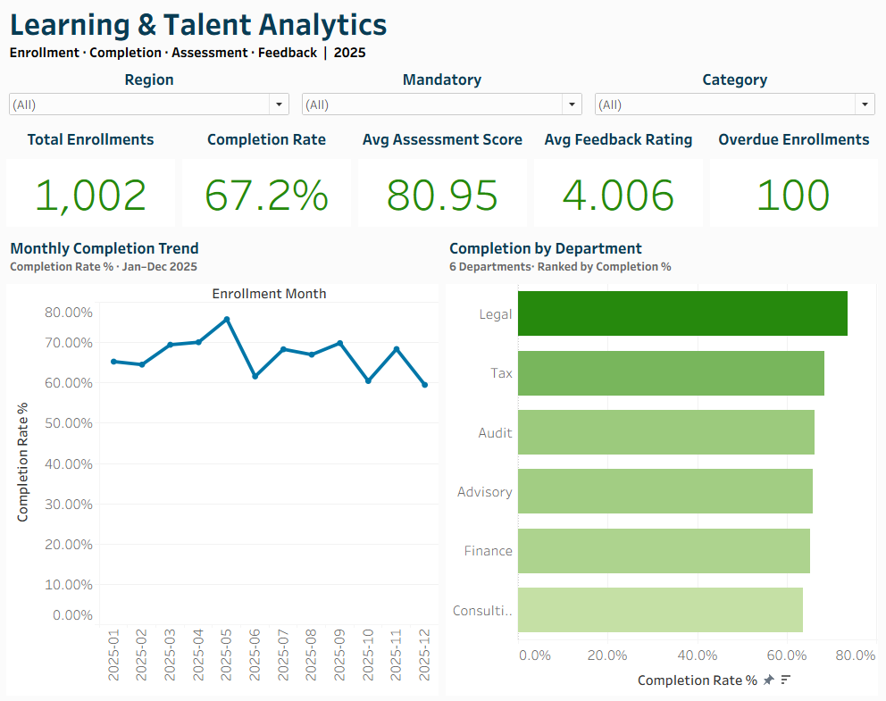
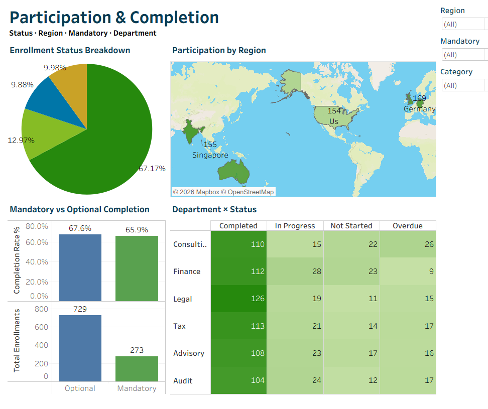
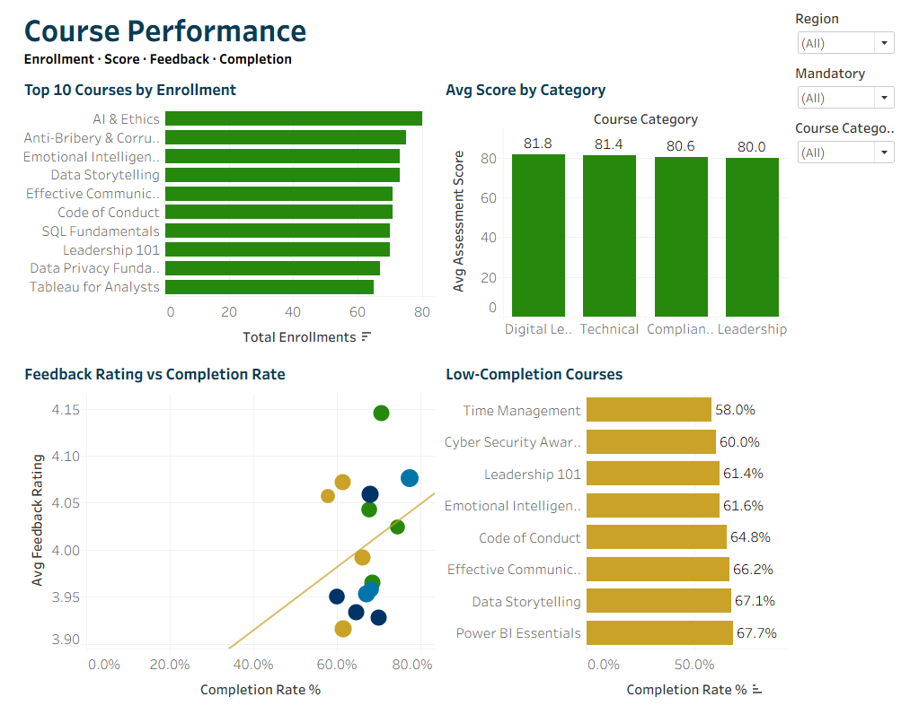
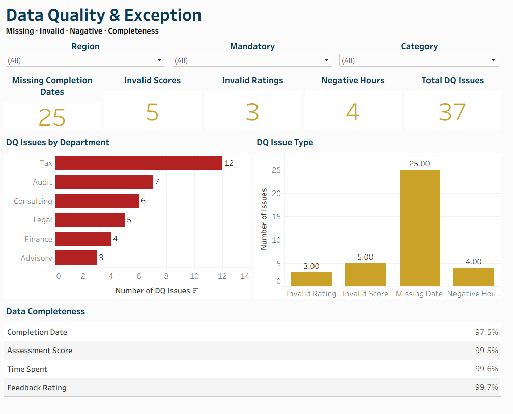

# Learning & Talent Analytics

An end-to-end portfolio project that cleans simulated employee learning data, evaluates training participation and completion, and prepares the results for SQL analysis and Tableau reporting.


> **Dataset note:** The LMS data is simulated for portfolio demonstration. Findings illustrate an analytics workflow and must not be interpreted as validated conclusions about a real workforce.

---

## Business Problem

Organizations need reliable visibility into employee training participation, completion, course outcomes, and overdue learning. Data quality problems such as missing completion dates or invalid scores can undermine those metrics.

This project demonstrates a reproducible workflow to:
- Clean and standardize learning-management data with Python.
- Preserve data-quality flags so issues remain auditable after cleaning.
- Load the prepared dataset into MySQL and analyse it with SQL.
- Present learning KPIs and exceptions through Tableau dashboards.

## Business Questions

1. What proportion of learning enrollments are completed?
2. Which departments, regions, and course categories have different completion patterns?
3. How many enrollments are overdue, including mandatory training?
4. How do assessment scores and learner ratings vary by course?
5. Which source-data issues could affect reporting reliability?

## Tools

| Tool | Use |
|---|---|
| Python, Pandas, NumPy | Data standardization, validation, feature engineering, and reporting |
| MySQL 8.0+ | Structured storage and analytical SQL |
| Tableau | Dashboarding and exploratory reporting |
| Git / GitHub | Version control and project documentation |

---

## Dataset and Data Quality

The repository contains a simulated raw LMS export and the cleaned output generated by the Python pipeline.

| Metric | Value |
|---|---:|
| Raw rows | 1,030 |
| Duplicate rows removed | 28 |
| Clean rows | 1,002 |
| Columns in cleaned dataset | 26 |
| Data-quality issue instances | 37 |

### Data-quality issue instances

| Issue | Count |
|---|---:|
| Completed records missing completion dates | 25 |
| Assessment scores outside the 0–100 range | 5 |
| Feedback ratings outside the 1–5 range | 3 |
| Negative learning-hour values | 4 |
| **Total issue instances** | **37** |

The counts represent flagged issue instances, not necessarily 37 unique records. The pipeline preserves Boolean flags for each issue and sets invalid numeric measurements to missing values so they do not distort averages. Missing scores and ratings for incomplete enrollments are expected in this dataset and are not automatically classified as invalid.

Duplicate detection uses the combination of `Employee_ID`, `Course_ID`, and `Enrollment_Date`. Rows are removed only when that business key repeats.

---

## Key Metrics

The current committed cleaned dataset reports the following values. Re-run the pipeline to regenerate the cleaned CSV and report.

| KPI | Value |
|---|---:|
| Total enrollments | 1,002 |
| Completed enrollments | 673 |
| Completion rate | 67.17% |
| Overdue enrollments | 100 |
| Average valid assessment score | 80.95 |
| Average valid feedback rating | 4.006 / 5 |

**Interpretation:** Approximately 67% of enrollments are marked completed in this simulated dataset. The overdue count identifies records for further review; it does not, by itself, establish why training is overdue.

## Analytical Work

The SQL file contains queries for:
- Dataset volume, distinct employees, courses, departments, and regions.
- Duplicate-key and data-quality checks.
- Overall KPIs and status mix.
- Completion comparisons by department, region, mandatory status, course, and category.
- Monthly and quarterly trends.
- Completion-duration analysis.
- Course and department rankings using CTEs and window functions.

### Tableau dashboards

The repository includes screenshots and a packaged Tableau workbook for four dashboard views:

1. **Executive Summary** — headline KPIs and completion trends.
2. **Participation & Completion** — status and completion patterns across groups.
3. **Course Performance** — course-level scores and feedback.
4. **Data Quality & Exceptions** — flagged issues affecting reporting.

#### Executive Summary


#### Participation & Completion


#### Course Performance


#### Data Quality & Exceptions


---

## Repository Structure

```text
Learning_Talent_Analytics/
├── 00_raw_data/
│   └── learning_talent_data.csv
├── 01_clean_data/
│   └── learning_talent_clean.csv
├── 02_scripts/
│   ├── learning_analytics_pipeline.py
│   └── push_to_mysql.py
├── 03_sql/
│   └── 01_analysis_queries.sql
├── 04_tableau/
│   └── Learning_Talent_Analytics.twbx
├── 05_powerpoint/
│   └── Learning_Talent_Analytics.pptx
├── 06_screenshots/
├── 07_docs/
│   └── data_quality_report.txt
├── .env.example
├── requirements.txt
└── README.md
```

---

## Run the Project

### 1. Clone the repository

```bash
git clone https://github.com/rohanvaiyata3-jpg/Learning_Talent_Analytics.git
cd Learning_Talent_Analytics
```

### 2. Install dependencies

Use Python 3.10 or newer.

```bash
python -m pip install -r requirements.txt
```

### 3. Run the Python cleaning pipeline

```bash
python 02_scripts/learning_analytics_pipeline.py
```

The script reads `00_raw_data/learning_talent_data.csv`, then writes:
- `01_clean_data/learning_talent_clean.csv`
- `07_docs/data_quality_report.txt`

Paths are resolved relative to the project, so the command does not depend on a particular user's computer or current working directory. The raw input is not overwritten.

### 4. Configure MySQL (optional)

Create the database in your local MySQL instance:

```sql
CREATE DATABASE learning_talent_db;
```

Copy `.env.example` to a local file named `.env`, then enter your own MySQL credentials in that local file. **Never commit `.env` or real credentials.**

Windows Command Prompt:
```bat
copy .env.example .env
```

macOS / Linux:
```bash
cp .env.example .env
```

Then upload the cleaned dataset:

```bash
python 02_scripts/push_to_mysql.py
```

The uploader replaces the `learning_talent` table each time it runs. Use a development database and back up any table you need to preserve before rerunning it.

### 5. Run SQL analysis

Open `03_sql/01_analysis_queries.sql` in MySQL Workbench or another MySQL 8.0+ client after loading the table.

The `Mandatory` field is stored as `1` for mandatory training and `0` for optional training.

### 6. Open Tableau and presentation files

Open `04_tableau/Learning_Talent_Analytics.twbx` in Tableau Desktop or Tableau Reader. Depending on your local Tableau setup, you may need to reconnect the workbook to the included cleaned CSV or configure its data source.

The project summary presentation is available at `05_powerpoint/Learning_Talent_Analytics.pptx`.

---

## Recommendations to Investigate

Based on the simulated data and available measures:

1. Review the 100 overdue enrollments and identify whether they are mandatory, approaching deadlines, or blocked by other factors.
2. Compare completion rates across departments and categories, while checking group sizes before prioritizing interventions.
3. Improve upstream completion-date capture and monitor data-quality flags during each refresh.
4. Review course-level scores and feedback alongside completion rates before using any course as a benchmark.

These are investigation priorities, not causal conclusions. The simulated dataset does not establish why a group performs differently.

## Limitations and Next Steps

- The dataset is simulated; results are not evidence about an actual organization.
- The analysis is descriptive and does not prove that a course or department caused a particular outcome.
- A future iteration could add automated tests, refresh scheduling, and validated completion-time or overdue definitions with business stakeholders.

## Author

**Rohan Vaiyata**

- GitHub: [@rohanvaiyata3-jpg](https://github.com/rohanvaiyata3-jpg)
- LinkedIn: [rohan-vaiyata](https://www.linkedin.com/in/rohan-vaiyata/)
- Email: rohanvaiyata3@gmail.com

## License

This project is licensed under the MIT License. See [LICENSE](LICENSE).
